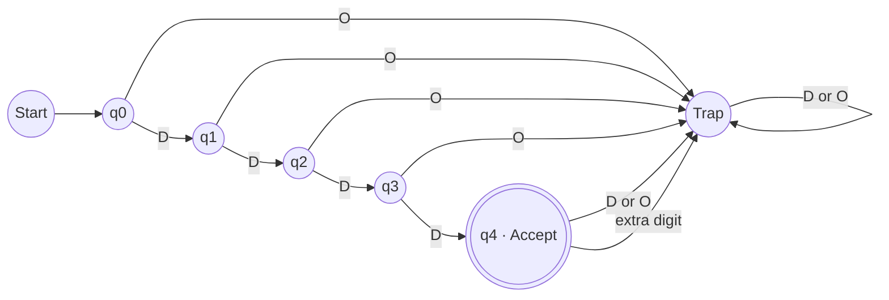
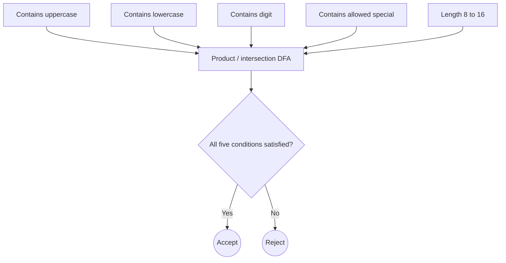
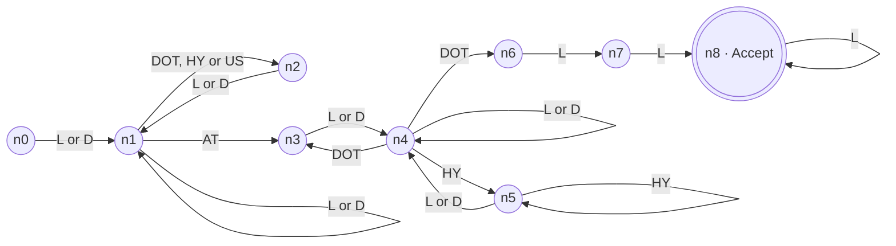
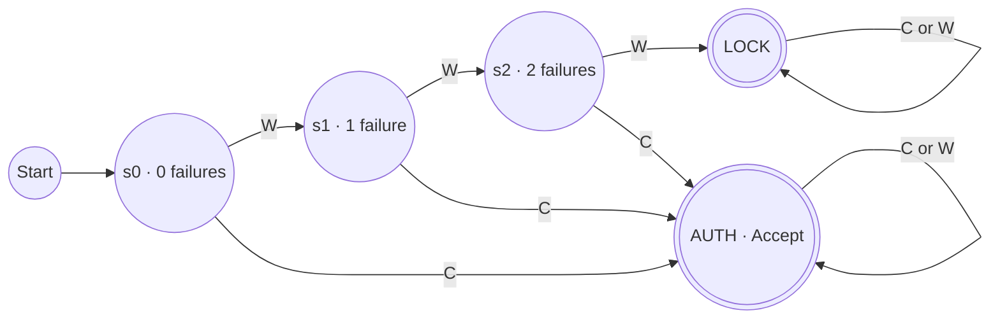

# Finite Automata for Real-Time Input Validation

**Course:** 21CSC301T – Formal Language and Automata  
**Student:** G Tarun Varma  
**Register number:** RA2411026050037  
**Implementation:** Python automata library + HTML/CSS/JavaScript browser demonstration

This project models three practical validation applications using finite automata:

1. ATM PIN format, weak-PIN detection, and consecutive-failure session lockout.
2. Password policy validation.
3. Simplified email-format validation using an NFA, subset construction, and DFA minimisation.

## Run locally

```bash
python -m pip install -r requirements.txt
python -m pytest -q
python -m fa_validators.cli
```

Open `docs/index.html` in a browser for the interactive demonstration. The browser demo is self-contained; the Python package is the reference implementation used by the automated tests.

## 1. ATM PIN

### PIN format DFA

The alphabet is `Σ = {D, O}`, where `D` denotes a decimal digit and `O` denotes any non-digit. The language is `L_PIN = { w ∈ D* : |w| = 4 }`.

States `q0` through `q4` count the digits consumed. `q0` is the start state, `q4` is the only accepting state, and `qD` is a rejecting trap state.

| State | D | O |
|---|---|---|
| q0 | q1 | qD |
| q1 | q2 | qD |
| q2 | q3 | qD |
| q3 | q4 | qD |
| q4 | qD | qD |
| qD | qD | qD |

State count: **5 live + 1 trap = 6 total**.

### Separate weak-PIN DFA

The weak-PIN language is `{0000, 1111, ..., 9999}`. This DFA uses the ten decimal digits as distinct symbols and accepts only four repetitions of the same digit. It has **41 live states + 1 trap = 42 total**. The complementary rule “four digits, not all identical” is represented by a separate minimized DFA with **34 live states + 1 trap = 35 total**.

This weak-PIN rule detects repeated-digit PINs only. It does not detect sequences, birthdays, or user-specific values.

### Session lockout DFA

The event alphabet is `{C, W}`: `C` means the external PIN comparison succeeded; `W` means it failed. Three consecutive `W` events move the machine to permanent `LOCK`. A correct event moves it to `AUTH`. The machine has five states: `s0`, `s1`, `s2`, `AUTH`, and `LOCK`.

| State | C | W |
|---|---|---|
| s0 | AUTH | s1 |
| s1 | AUTH | s2 |
| s2 | AUTH | LOCK |
| AUTH | AUTH | AUTH |
| LOCK | LOCK | LOCK |

The DFA does not compare a PIN with a bank record and does not model time-based unlocks.

## 2. Password policy

Policy: length 8–16 inclusive; at least one uppercase letter, lowercase letter, digit, and special character from `!@#$%^&*()-_=+[]{};:,.?/`; all other characters (including spaces) are rejected.

`Σ = {U, L, D, S, O}`. The accepted language is the intersection `L_U ∩ L_L ∩ L_D ∩ L_S ∩ L_len`. The product state tracks four class-presence flags and the length counter.

| Construction | Reachable states | Separate trap state | Total states |
|---|---:|---:|---:|
| Reachable product DFA | 240 | No separate trap; rejecting combinations are part of the product | 240 |
| Minimized DFA | 196 | 1 | 197 |

The product count is `1 + 5 + 11 + 15 + 13×16 = 240`. The minimized count is computed by the implementation's table-filling algorithm.

## 3. Email format

This is a deliberately simplified subset of common email syntax, not a complete RFC 5322 parser:

```text
local  = alnum+ ( [._-] alnum+ )*
domain = label ( "." label )* "." tld
label  = alnum+ ( "-"+ alnum+ )*
tld    = letter{2,}
```

`alnum` is an ASCII letter or digit. The NFA uses `Σ = {L, D, DOT, HY, US, AT, O}`. On a domain dot, it nondeterministically chooses whether another domain label or the TLD follows.

| Stage | Live states | Trap | Total |
|---|---:|---:|---:|
| NFA | 9 | — | 9 |
| Subset DFA | 9 | 1 | 10 |
| Minimized DFA | 8 | 1 | 9 |

The subset DFA has nine reachable non-empty subsets. Minimisation merges `{n0}` and `{n2}` because their future language is identical: both require an alphanumeric character next.


## Automata diagrams

The diagrams below are rendered by GitHub from Mermaid source, so no separate screenshots or image assets are needed.

### ATM PIN format DFA



### Password validator construction

The password recognizer is built as the product/intersection of four class-presence DFAs and one length DFA. This construction view is more readable than drawing all reachable product states in one diagram.



### Email-format NFA



The two outgoing `DOT` transitions from `n4` are the NFA's nondeterministic choice: continue with another domain label (`n3`) or begin the final TLD (`n6`).

### ATM consecutive-failure lockout DFA



## Test cases

| Application | Accepted examples | Rejected examples |
|---|---|---|
| PIN | `4821`, `0000`, `9375`, `1234`, `0042` | `123`, `12345`, `12a4`, `12 4`, empty |
| Weak PIN | `0000`, `1111`, `2222`, `9999` | `1234`, `1000`, `0001`, `12a4`, empty |
| Password | `Srm@2026`, `Trichy#Aiml5`, `aB3$efgh`, `P@ssw0rdX`, `Q1w2e3r4!T` | `srm@2026`, `SRM@2026`, `Srm@Trichy`, `Srm20266`, `Srm @2026` |
| Email | `tarun.varma@srmist.edu.in`, `ra2411026050037@srmist.edu.in`, `student_one@gmail.com`, `alex-raj@my-site.co`, `user123@college.org` | `student@college`, `.tarun@gmail.com`, `student..one@gmail.com`, `student@-college.in`, `student@gmail.c` |

## Syntax versus semantic validation

- A four-digit PIN's format does not prove it belongs to a particular bank account; that requires an external secure comparison.
- A syntactically valid email does not prove the domain or mailbox exists; DNS and mailbox verification are separate.
- A syntactically valid password may still be weak under additional rules (common sequences, personal information, or breach-list checks) not included in this DFA.
- Finite automata cannot perform unbounded counting such as requiring equal numbers of letters and digits.

## Project structure

```text
fa_validators/       DFA/NFA toolkit and validator definitions
tests/               automated verification tests
docs/                browser demo (HTML/CSS/JavaScript)
README.md            project documentation
```
